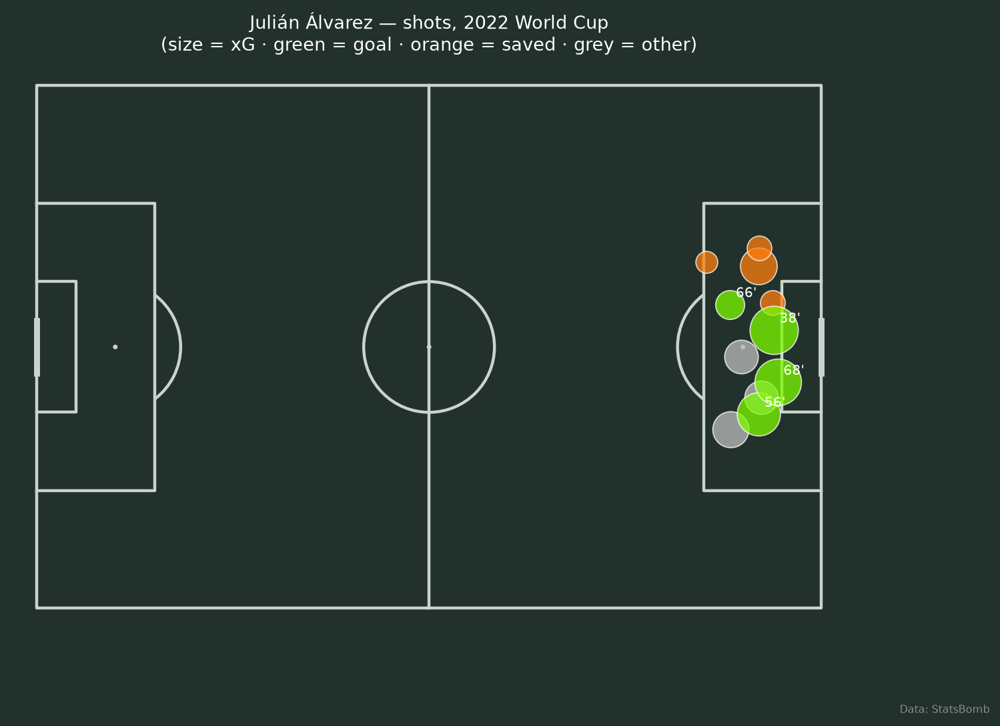
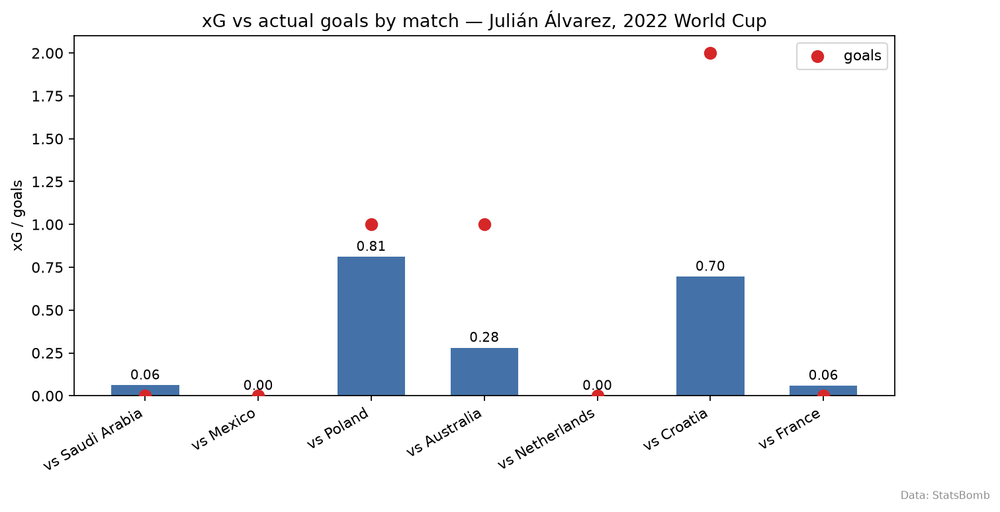
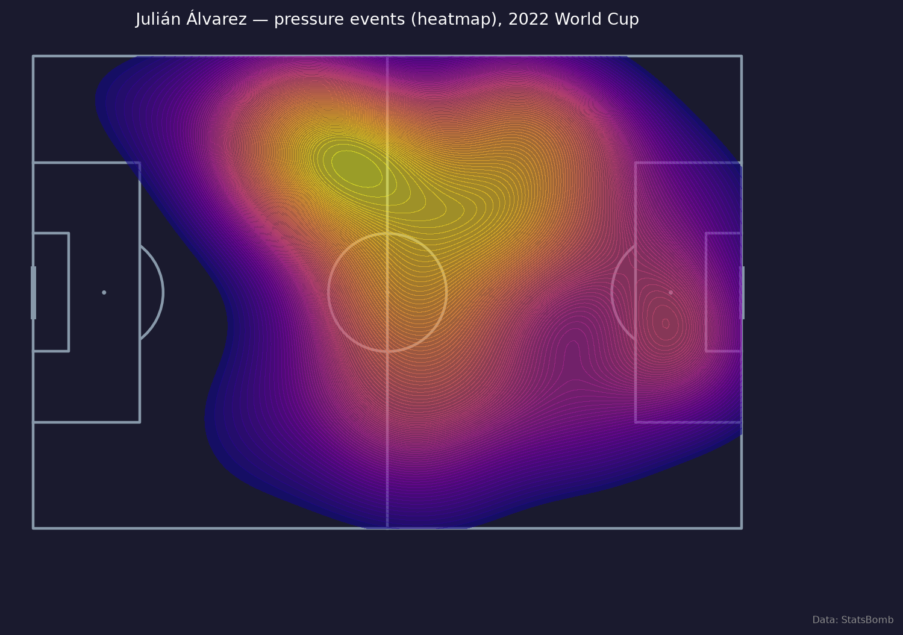
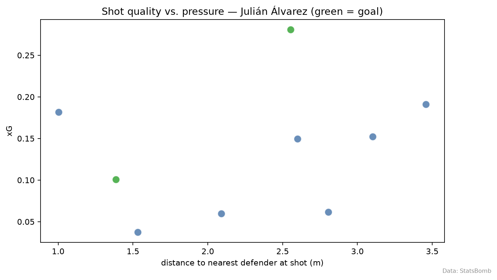

# Julián Álvarez — 2022 World Cup Player Profile

A player profile built on **StatsBomb open data** (event data + 360 freeze
frames) for Argentina's run at the 2022 World Cup. One script, real numbers,
figures included.

**Data: StatsBomb** (open data, used under the StatsBomb Public Data User
Agreement). Data: [github.com/hudl/open-data](https://github.com/hudl/open-data).

## What this shows

Julián Álvarez (ID 29560) across Argentina's 7 matches. The point is not
another heatmap: the 360 frames let us measure **pressure on every shot** —
how close the nearest defender was when he pulled the trigger, something
plain event data cannot tell you.

## Numbers

| Metric | Value |
|---|---|
| Shots | 11 (in 5 of 7 matches) |
| Goals | 4 |
| Total xG | 1.91 |
| Goals − xG | **+2.09** |
| xG per shot | 0.173 |
| Shot assists | 2 |
| Nearest defender at shot, mean | **2.28 m** (median 2.55 m) |
| Shots with a defender inside 2 m | 3 of 9 (with a 360 frame) |
| Ball receipts | 193 (22 under pressure, 11 %) |
| Pressure events | 118 |

## What the data says

- **He out-finished his chances.** 4 goals from 1.91 xG. The tournament's
  hottest striker on a per-shot basis: his goals came from chances an average
  finisher converts about half the time. The two big hauls: 0.81 xG vs Poland
  (1 goal) and 0.70 vs Croatia (2 goals).
- **His shots come with a defender on him.** Mean nearest defender 2.28 m at
  the moment of the shot, and 3 of his 9 framed shots had a defender inside
  2 m. The scatter (shot_pressure.png) shows his goals split between a
  contested finish (~1.4 m) and a cleaner one (~2.6 m) — the profile of a
  striker who gets his shot off **through** contact, not away from it.
- **He presses like a midfielder, not a striker.** 118 pressure events,
  concentrated in the opponent's half (pressure_map.png): Argentina's first
  line of the high block ran through him.
- **He was rarely pressured himself** (11 % of receptions) — Argentina's
  possession game meant he usually received facing forward. The defensive
  effort was his, not the other way around.

## Reproduce

**Notebook (recommended):** `analysis/profile.ipynb` — open it on GitHub (it
renders with all figures embedded) or run locally:

```bash
pip install pandas matplotlib mplsoccer jupyter
jupyter execute analysis/profile.ipynb --inplace   # from the repo root
```

**Script:** `python analysis/profile.py` (same figures, writes to `output/`).

`data/` holds the 7 Argentina matches of the 2022 World Cup (events +
360 frames). Downloaded from StatsBomb open data on 2026-11-13.

## Figures





